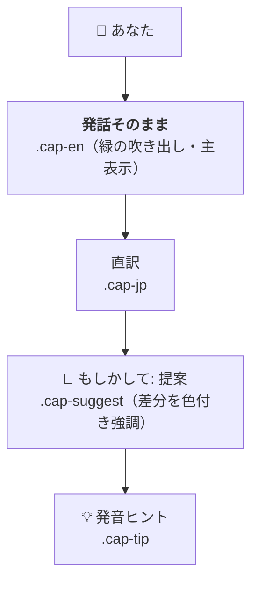
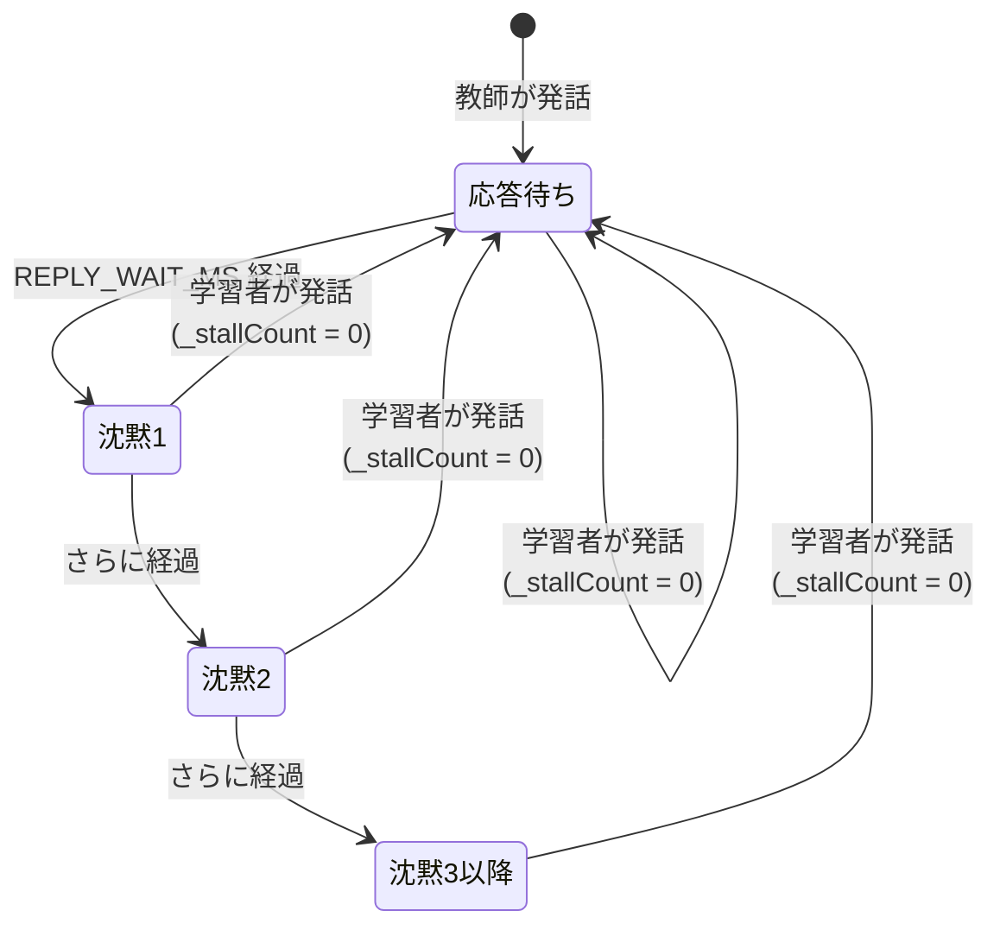
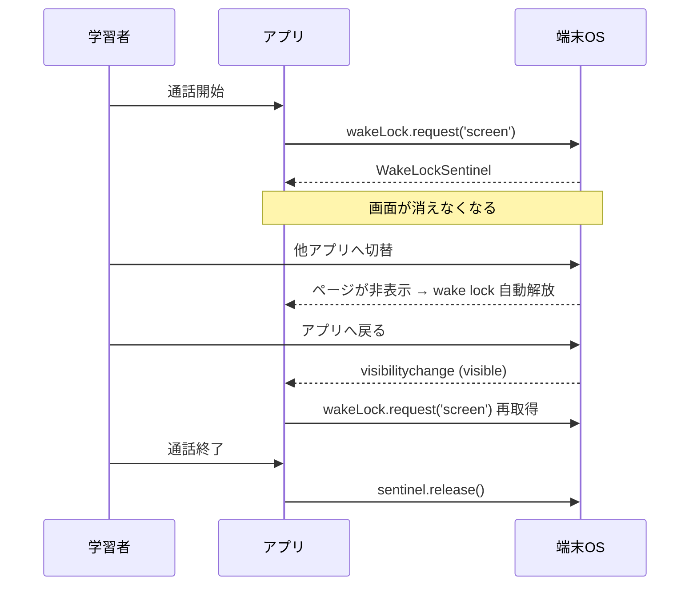

# 会話表示・会話継続 仕様書

最終更新: 2026-08-25 / 対象: `index.html`（メインアプリ）

## 1. 目的・背景

本アプリは Gemini API を使ったブラウザ完結型の英会話練習アプリである。
学習者（日本語話者）が英語で話しかけ、AI教師が英語で応答する。

2026-08-25 に、実利用で次の3つの問題が報告された。本仕様書はその修正内容を定義する。

| # | 報告された問題 | 影響 |
|---|---|---|
| 1 | 発話した言葉が画面上で勝手に書き換えられる | 自分が何と認識されたか分からず、発音改善につながらない |
| 2 | 会話が続かないとき、教師が話題を変えてしまう | 英語レベルが合っていないのに、より難しい話題へ進んでしまう |
| 3 | 操作せずにいると画面が消えて会話が止まる | 通話が中断される |

## 2. 発話表示仕様

### 2.1 基本原則

> **学習者が発話した言葉は、いかなる理由があっても書き換えて表示しない。**

音声認識の誤認識・文法誤り・不自然な語順があっても、認識されたテキストをそのまま主表示に残す。
補正は「置き換え」ではなく「下に添える提案」として扱う。

### 2.2 表示要素と順序



| 要素 | CSSクラス | 内容 | 出力条件 |
|---|---|---|---|
| 発話 | `.cap-en` | 音声認識またはテキスト入力の結果**そのまま** | 常に |
| 直訳 | `.cap-jp` | 発話英文の**逐語的な**日本語訳 | `userJapanese` が非空 |
| 提案 | `.cap-suggest` | より自然／意図した言い方 | `userEnglishCorrected` が発話と異なるとき |
| 発音ヒント | `.cap-tip` | 認識ミスや発音の解説 | `pronunciationTip` が非空 |

### 2.3 表示例

学習者が "I play tennis" と言ったが "I pray tennis" と認識された場合：

```
🙋 あなた
┌──────────────────────────────┐
│ I pray tennis every weekend  │   ← 認識されたまま（書き換えない）
└──────────────────────────────┘
私は毎週末テニスを祈ります              ← 直訳（意訳しない）
💬 もしかして: I play tennis every weekend   ← play を強調表示
💡「pray」と認識されました。「play」は「プレイ」に近い音です。
```

### 2.4 AIへの指示（システムプロンプト）

「返答の解釈」と「発話の表示」を明確に分離する。

| 用途 | 方針 | JSONフィールド |
|---|---|---|
| 教師の返答 | **文脈で解釈してよい。** 誤認識で会話を脱線させない | `english` / `japanese` |
| 発話の日本語訳 | **逐語訳のみ。** 意訳・文脈補正を禁止 | `userJapanese` |
| 補正案 | 意図した／自然な言い方 | `userEnglishCorrected` |
| 認識ミスの指摘 | ここに集約する | `pronunciationTip` |

> 修正前は `userJapanese` について「AIが推測した意図を訳せ（実際の発話ではなく）」と
> 明示的に指示していた。これが問題1の直接原因である。

## 3. 会話継続仕様（沈黙時の段階的な平易化）

### 3.1 基本原則

> **会話が続かない主因は「英語が難しすぎること」である。**
> 話題を変える前に、まず同じ話題をより易しい言葉で言い換える。

### 3.2 状態遷移



| 連続沈黙回数 | 教師の振る舞い | 話題 |
|---|---|---|
| 1回目 | 同じ質問を、より簡単で一般的な語に言い換える。Yes/No で答えられる長さにする | **変えない** |
| 2回目 | さらに1段階易しく。8語以内、選択肢を提示（例: "Coffee or tea?"） | **変えない** |
| 3回目以降 | より身近な話題（食べ物・天気・家族）へ切り替え、簡単な Yes/No 質問で始める | 変える |

- カウンタ `_stallCount` は、学習者が発話した時点（`sendMessage`）と通話開始時（`startCall`）に 0 へ戻る
- 沈黙は「レベルを1段下げる」根拠としてもシステムプロンプトに反映する

### 3.3 発動条件

沈黙検知は**マイクON中のみ**発動する。ミュート中は学習者が意図的に黙っている可能性が高いため。

## 4. 画面スリープ防止仕様

### 4.1 背景

画面が消えると、マイク（`getUserMedia`）・音声認識（Web Speech API）・読み上げ（`speechSynthesis`）が
まとめて停止し、会話が中断する。ブラウザからこれらをバックグラウンドで継続させる手段は無いため、
**画面を消させないことが唯一の対処**となる。

### 4.2 動作



- 取得: `startCall()`
- 解放: `endCall()`
- **再取得: `visibilitychange` で可視になったとき（通話中かつ未保持の場合のみ）**
  - wake lock はページが非表示になると自動解放される。この再取得が無いと、
    他アプリから戻った後は二度と効かなくなる

### 4.3 非対応・失敗時の扱い

| 状況 | 判定方法 | 動作 |
|---|---|---|
| 端末が非対応 | `'wakeLock' in navigator` が false | 「端末の自動ロックを長め／オフに」と案内する |
| 一時的に取得失敗 | `request()` が reject | **案内を出さない。** `visibilitychange` で取り直す |

> 「非対応」と「今は取れなかっただけ」を区別する。ページが非表示のときや低電力モードでは
> `NotAllowedError` で拒否されるが、これは端末が非対応であることを意味しない。
> 区別せずに案内を出すと、対応端末でも誤った警告が出てしまう。

### 4.4 制約（実現できないこと）

- すでに消えた画面を点け直すことはできない（消えるのを防ぐだけ）
- ユーザーが電源ボタンで消した場合、他アプリへ切り替えた場合は効かない
- iOS Safari は 16.4 以降のみ対応。Android Chrome は対応
- 低電力モードでは OS が拒否することがある
- 画面が点灯し続けるためバッテリー消費は増える

## 5. APIエラー表示仕様

`explainApiError()` が Gemini API のエラーを日本語に変換する。

| 条件 | 表示 |
|---|---|
| `API key not valid` / `API_KEY_INVALID` | APIキーが無効です |
| `invalid authentication credentials` / `UNAUTHENTICATED` / `401` | APIキーが無効です（失効または削除された可能性があります） |
| `quota` / `RESOURCE_EXHAUSTED` / `429` | API利用上限に達しました |
| `PERMISSION_DENIED` / `403` | アクセス権限エラー |
| `SAFETY` / `blocked` | 安全フィルターによるブロック |
| `AbortError` | タイムアウト |
| `Failed to fetch` / `NetworkError` | ネットワークエラー |
| `500` / `503` / `UNAVAILABLE` | サーバー一時エラー |

## 6. 非機能要件・制約

- 通信先は `generativelanguage.googleapis.com` のみ（CSP `connect-src` で制限）
- APIキーは `localStorage`（`lm_api_key`）に保存し、**ブラウザ／プロファイルごとに独立**する。
  端末を変えたら再登録が必要
- 表示に使う文字列はすべて `escHtml()` またはDOM APIの `textContent` を経由してXSSを防ぐ。
  `diffHighlight()` の出力はエスケープ済みHTML
